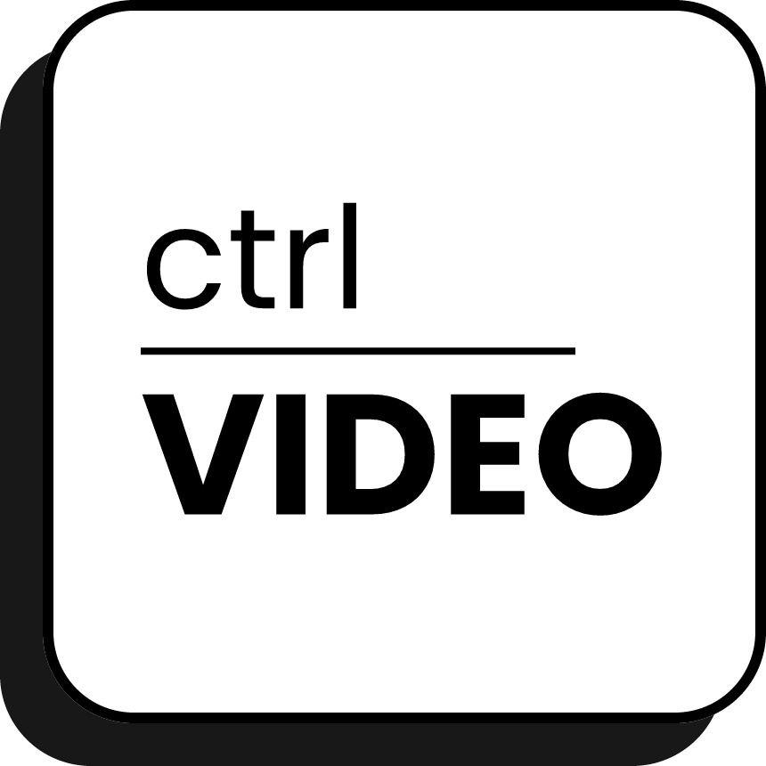

# ctrl+video

<p align="center">
  
</p>

<p align="center">
  <b>A tactile, desktop-first video downloader and clip trimming studio powered by Flutter, yt-dlp, and libmpv.</b>
</p>

<p align="center">
  
  
  
  
  
</p>

---

## 💡 About ctrl+video

**ctrl+video** is a clean, privacy-focused desktop application for downloading, extracting, and frame-accurate trimming of videos. Unlike web services that proxy media through external servers, **ctrl+video runs 100% locally on your machine and network**.

It leverages bundled, auto-updating sidecar engines (**yt-dlp**, **ffmpeg**, and **libmpv**) to give you granular format and codec control without telemetry, cloud dependencies, or user tracking.

---

## 🌟 Key Features

- **🎬 Multi-Stream Format & Codec Mastery**:
  - **Video**: Select presets (Best Auto, 1080p, 720p, 480p) or containers (MP4, MKV, WebM).
  - **Audio Only**: Extract to MP3, M4A (AAC), FLAC (Lossless), Opus, or WAV with bitrate presets (320k, 192k, 128k).
  - **Advanced Stream Picker**: Inspect individual video/audio streams, view bitrates, frame rates, dynamic range (SDR/HDR), and exact codec tags (AV1, VP9, H.264, AAC, Opus).
- **📺 In-App Preview Player (`media_kit` + libmpv)**:
  - Low-bandwidth native desktop stream preview before downloading.
  - Keyboard shortcuts: `Space` (Play/Pause), `←` / `→` (Seek ±5s).
- **✂️ Frame-Accurate Video Trimming**:
  - Interactive timeline scrubber with dual start/end handles.
  - **Exact Mode**: Re-encodes boundary frames around cuts (`--force-keyframes-at-cuts`) for sub-second accuracy.
  - **Fast Mode**: Instant keyframe snap cuts (`--download-sections`) without re-encoding.
  - Quick shortcuts: `[I]` (Start at Playhead) and `[O]` (End at Playhead) with millisecond-exact `HH:MM:SS.mmm` manual inputs.
  - Built-in **Trim Preview** looping.
- **🖥️ Viewport-Fitted Desktop Workspace**:
  - Two-pane responsive workspace (Preview player on left, configuration options on right) that fits your viewport with zero page scrolling.
  - Non-intrusive floating toast notifications when downloads start.
- **⚡ Global Command Palette (`Ctrl+K` / `Cmd+K`)**:
  - Instant modal launcher for rapid tab switching, clipboard paste-and-fetch, and queue controls.
- **📥 Download Queue & Animated Progress**:
  - Smooth animated percentage progress bars with live download speed, ETA counters, and cancel/retry options.
- **📖 Comprehensive Download History**:
  - Drift (SQLite) local storage recording download date/time, elapsed duration, file size, format, and trim parameters with one-click file/folder opening.
- **🔄 Self-Healing Sidecar Engine**:
  - Checks for latest `yt-dlp` updates from GitHub with SHA-256 validation and automatic atomic rollback on failure.

---

## 📦 Installation Guide

Pre-compiled binary releases for all three desktop platforms are available on the [Releases](https://github.com/ziver-technologies-pvt-ltd/ctrl-video/releases) page.

### 🐧 Linux

#### Option A: Running from Release Tarball
1. Download `ctrl_video-linux-x64.tar.gz` from the latest release.
2. Ensure runtime dependencies are installed:
   - **Ubuntu / Debian**:
     ```bash
     sudo apt-get update
     sudo apt-get install -y libgtk-3-0 libasound2 libmpv2
     ```
   - **Fedora / RHEL**:
     ```bash
     sudo dnf install gtk3 alsa-lib mpv-libs
     ```
   - **Arch Linux**:
     ```bash
     sudo pacman -S gtk3 alsa-lib mpv
     ```
3. Extract and launch:
   ```bash
   tar -xzf ctrl_video-linux-x64.tar.gz
   ./ctrl_video
   ```

---

### 🪟 Windows

1. Download `ctrl_video-windows-x64.zip` from the latest release.
2. Extract the archive into your preferred directory (e.g., `C:\Program Files\ctrl+video` or your desktop).
3. Ensure the [Microsoft Visual C++ Redistributable](https://learn.microsoft.com/en-us/cpp/windows/latest-supported-vc-redist) is installed (standard on most Windows systems).
4. Run `ctrl_video.exe`.

> **Note:** If Windows SmartScreen shows an unrecognized application prompt on first launch, click **More info** → **Run anyway**.

---

### 🍏 macOS

1. Download `ctrl_video-macos.tar.gz` from the latest release.
2. Extract the archive:
   ```bash
   tar -xzf ctrl_video-macos.tar.gz
   ```
3. Move `ctrl_video.app` to your `/Applications` folder:
   ```bash
   mv ctrl_video.app /Applications/
   ```
4. Launch `ctrl+video` from Spotlight or Applications.

> **First Launch Gatekeeper Notice:**
> If macOS displays *"ctrl+video cannot be opened because the developer cannot be verified"*:
> 1. Open **System Settings** → **Privacy & Security**.
> 2. Scroll to the **Security** section and click **Open Anyway**.
> Alternatively, remove the quarantine attribute via terminal:
> ```bash
> xattr -cr /Applications/ctrl_video.app
> ```

---

## 🛠️ Building from Source

### Prerequisites
- [Flutter SDK](https://flutter.dev/docs/get-started/install) (v3.50.0 or later on `stable` channel)
- Git & Python 3

#### Linux Build Dependencies
- **Ubuntu / Debian**:
  ```bash
  sudo apt-get update
  sudo apt-get install -y clang cmake ninja-build pkg-config libgtk-3-dev liblzma-dev libasound2-dev libmpv-dev
  ```
- **Fedora / RHEL**:
  ```bash
  sudo dnf install clang cmake ninja-build gtk3-devel mesa-libGL-devel alsa-lib-devel mpv-devel
  ```

#### Windows Build Dependencies
- Visual Studio 2022 with **Desktop development with C++** workload.

#### macOS Build Dependencies
- Xcode and Command Line Tools (`xcode-select --install`).

---

### Step-by-Step Build Instructions

1. **Clone the repository:**
   ```bash
   git clone https://github.com/ziver-technologies-pvt-ltd/ctrl-video.git
   cd ctrl-video
   ```

2. **Install Flutter packages:**
   ```bash
   flutter pub get
   ```

3. **Fetch sidecar engine binaries:**
   - **Linux**:
     ```bash
     ./scripts/fetch_linux_engine.sh
     ```
   - **Windows** (PowerShell):
     ```powershell
     New-Item -ItemType Directory -Force -Path "assets/engine/windows-x64"
     Invoke-WebRequest -Uri "https://github.com/yt-dlp/yt-dlp/releases/latest/download/yt-dlp.exe" -OutFile "assets/engine/windows-x64/yt-dlp.exe"
     ```
   - **macOS**:
     ```bash
     mkdir -p assets/engine/macos-arm64 assets/engine/macos-x64
     curl -L -o assets/engine/macos-arm64/yt-dlp_macos https://github.com/yt-dlp/yt-dlp/releases/latest/download/yt-dlp_macos
     chmod +x assets/engine/macos-arm64/yt-dlp_macos
     cp assets/engine/macos-arm64/yt-dlp_macos assets/engine/macos-x64/yt-dlp_macos
     ```

4. **Run unit & widget test suite:**
   ```bash
   flutter test
   ```

5. **Run in development:**
   ```bash
   flutter run
   ```

6. **Compile release package:**
   - **Linux**: `flutter build linux --release`
   - **Windows**: `flutter build windows --release`
   - **macOS**: `flutter build macos --release`

---

## 🔒 Security & Privacy

- **Zero Cloud Intermediaries**: Downloads connect directly from your machine to the source media server.
- **No Command Injection**: All process invocations execute with explicit argument lists and strict `--` operand boundaries (`runInShell: false`).
- **Domain Whitelisting**: Restricts metadata operations strictly to verified media platforms (`YouTube`, `Instagram`, `Facebook`).

---

## 📄 License
This project is licensed under the MIT License. See [LICENSE](LICENSE) for details.
